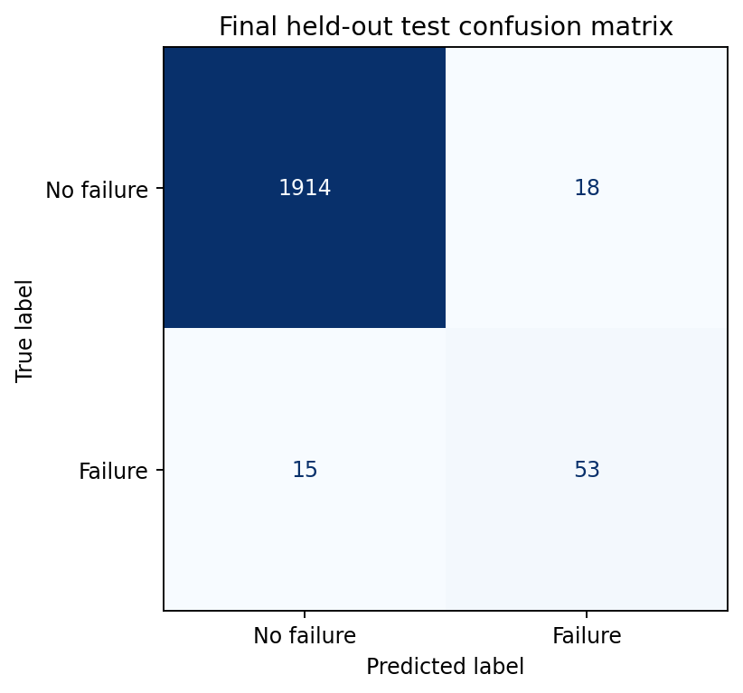
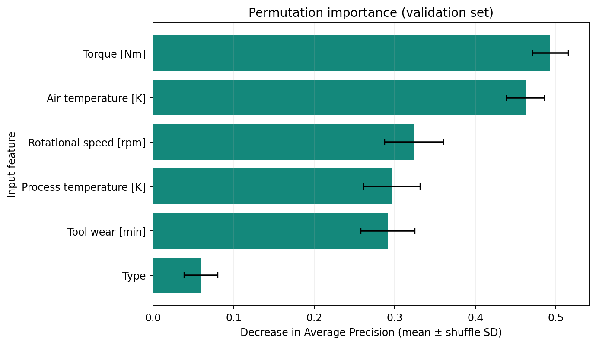

# Predictive Maintenance: Machine Failure Prediction

A reproducible Python and scikit-learn portfolio project for classifying machine failure from six operational inputs. It includes a readable notebook, training and prediction commands, measured results, and an interview study guide.

## Overview

Maintenance teams want to identify suspicious operating conditions while controlling false alarms. This project studies that classification trade-off on the **official UCI AI4I 2020 dataset**. It is an academic benchmark, with no industrial deployment or measured financial impact.

## Problem Statement

Given product type and five sensor/usage measurements, estimate the probability score for `Machine failure = 1` and apply a validation-selected threshold.

**The label describes failure at the recorded observation.** There is no specified advance-warning horizon, timestamp, or remaining-useful-life target. This project does not establish that a failure can be predicted hours or days ahead.

## Dataset

- **Name:** AI4I 2020 Predictive Maintenance Dataset.
- **Source:** [UCI dataset 601](https://archive.ics.uci.edu/dataset/601/ai4i+2020+predictive+maintenance+dataset); [dataset DOI](https://doi.org/10.24432/C5HS5C).
- **Nature:** the dataset provider generated synthetic industrial-style observations. This project uses the original CSV unchanged; it does not generate substitute training data.
- **Observed size:** 10,000 rows and 14 columns; 339 failures (3.39%). One row is an operating observation, not a verified distinct machine.
- **Quality checks on the CSV:** no missing cells, complete duplicate rows, or duplicate combinations of the six inputs. These facts are calculated in `reports/data_quality.json`.
- **Attribution:** AI4I 2020 Predictive Maintenance Dataset (2020), UCI Machine Learning Repository, DOI `10.24432/C5HS5C`. Related paper: Stephan Matzka, *Explainable Artificial Intelligence for Predictive Maintenance Applications* (2020), DOI `10.1109/AI4I49448.2020.00023`.
- **Dataset license:** [CC BY 4.0](https://creativecommons.org/licenses/by/4.0/), as stated by UCI. The repository's MIT source-code license does not replace this license.

| Column | Role | Treatment |
| --- | --- | --- |
| `Type` | Product quality category: L, M, H | One-hot encoded |
| `Air temperature [K]` | Numerical input | Median imputation; scaled for logistic regression |
| `Process temperature [K]` | Numerical input | Same |
| `Rotational speed [rpm]` | Numerical input | Same |
| `Torque [Nm]` | Numerical input | Same |
| `Tool wear [min]` | Numerical input | Same |
| `Machine failure` | Binary target | Never included in inputs |
| `UDI`, `Product ID` | Identifiers | Excluded; UDI used only to audit row assignments |
| `TWF`, `HDF`, `PWF`, `OSF`, `RNF` | Failure-mode outcomes | Excluded as target-related leakage |

### Explicit leakage analysis

TWF (tool wear), HDF (heat dissipation), PWF (power), OSF (overstrain), and RNF (random failure) are recorded failure outcomes. They are not legitimate pre-outcome sensor inputs. Even imperfect outcome indicators would give the model information unavailable at the intended decision point.

The CSV is **not perfectly consistent** with an exact OR relationship: there are **27 mismatches**, consisting of 9 target-positive rows with no positive flag and 18 target-negative rows with at least one positive flag. We preserve the supplied `Machine failure` target and all rows, report the discrepancy, and exclude all five flags. We do not silently “repair” labels or train on reconstructed outcomes. The official narrative also contains counts that differ from the CSV; measured CSV counts are authoritative for this experiment.

`prepare_xy()` uses an explicit allowlist. `ColumnTransformer(remainder="drop")` adds a second protection. Identifiers are excluded because they encode row/product identity and may create shortcuts; useful quality information is already represented by `Type`.

## Key Challenges

- **Class imbalance:** a model predicting no failure can appear accurate while catching none.
- **Leakage:** failure-mode labels reveal outcome information.
- **Threshold choice:** more detected failures can come with more false alarms.
- **Generalization:** random-walk sensor generation creates dependence; a random holdout is not a prospective factory test.

## Project Workflow

1. Verify the official CSV checksum, schema, data quality, and target-related columns.
2. Make fixed, stratified partitions: 64% fitting, 16% threshold validation, 20% final test.
3. Perform sensor/target EDA on the **fitting partition only**. Full-data checks are limited to the schema, quality audit, and class counts.
4. Compare the baseline and three models using five-fold stratified CV within fitting data.
5. Select by mean CV Average Precision and tune only the strongest real classifier with eight configurations.
6. Fit the selected pipeline on the fitting partition; select a threshold on validation data.
7. Calculate validation permutation importance without changing the selected features/model.
8. Freeze the pipeline and threshold; predict the test partition once and produce all final metrics/plots from that prediction vector.

The fitted model is deliberately **not refit on the validation rows**, so its score scale remains the one used to select the threshold. The cost is fewer fitting examples. No test scores guide model, parameter, or threshold selection. The threshold step precedes final testing even though its chart is also shown later in the notebook.

## Technologies Used

- **Python, NumPy and pandas:** data validation, preparation, and analysis.
- **scikit-learn:** preprocessing pipelines, classification, cross-validation, tuning, evaluation, and permutation importance.
- **Matplotlib:** exploratory and evaluation figures.
- **joblib and threadpoolctl:** model persistence and controlled numerical threading.
- **pytest:** automated checks for leakage protection, splits, preprocessing, inference, and saved results.
- **Jupyter/IPython:** an explanatory notebook backed by reusable source modules.

## Models

| Model | Why it is included | Imbalance and preprocessing |
| --- | --- | --- |
| DummyClassifier (`prior`) | Exposes the weakness of accuracy on an imbalanced target | Learns class prevalence; predicts the majority class |
| Logistic Regression | Understandable linear reference | Balanced class weights; numeric scaling |
| Random Forest | Learns nonlinear splits and interactions with bagged trees | Balanced weights initially; scaling unnecessary |
| HistGradientBoostingClassifier | A complementary boosted-tree model using only scikit-learn | Dense one-hot features; balanced weights initially; scaling unnecessary |

All pipelines impute numerical values with training-fold medians and categorical values with the training-fold mode. The verified dataset has no missing values; this is defensive preprocessing. Prediction input validation requires complete values. One-hot output is dense (only eight transformed columns), making it compatible with histogram boosting. No SMOTE, PCA, deep learning, or external boosting library is needed.

The chosen family is tuned using `GridSearchCV` with the same five folds and `scoring="average_precision"`. The grid includes unweighted and balanced variants, so weighting is a tested choice rather than an assumed improvement. The chosen grid and every score are saved in `reports/tuning_results.csv` and `reports/results.json`.

## Evaluation Metrics

- **Accuracy:** fraction of all observations classified correctly; misleading on its own here.
- **Precision:** among flagged observations, the fraction that really failed.
- **Recall:** among actual failures, the fraction detected.
- **F1:** harmonic mean of precision and recall at a specific threshold.
- **ROC-AUC:** ranking performance across thresholds; use alongside positive-class metrics.
- **Average Precision (AP):** summarizes precision across recall increases; the primary model-selection metric. It emphasizes retrieval of the rare positive class. This project reports AP, **not trapezoidal PR-AUC**.
- **Confusion matrix and classification report:** expose missed failures and false alarms directly.

The threshold maximizes validation F1 on a predeclared grid from 0.05 to 0.95 in steps of 0.05; ties choose the higher threshold. F1 treats precision and recall symmetrically. This is an educational operating rule, not an economically optimal threshold. Probabilities are uncalibrated model scores, particularly when class weighting is used.

## Results

This block is refreshed from executed artifacts by `src.reporting`; no metric is manually guessed.

<!-- RUN_RESULTS_START -->

Measured run: `2026-10-05T09:26:10.112041+00:00`. Seed: `42`.

**Selected model: HistGradientBoosting**. Decision threshold: **0.10**, selected by validation F1 before test evaluation.

Partition sizes — fit: 6,400 rows / 217 failures; validation: 1,600 rows / 54 failures; test: 2,000 rows / 68 failures.

Training-only, five-fold comparison (classification metrics use each model's default decision rule):

| Model | CV AP (mean ± fold SD) | CV ROC-AUC | Precision | Recall | F1 | Accuracy |
| --- | --- | --- | --- | --- | --- | --- |
| HistGradientBoosting | 0.7373 ± 0.0752 | 0.9642 | 0.6393 | 0.7647 | 0.6943 | 0.9770 |
| Random Forest | 0.7268 ± 0.0968 | 0.9615 | 0.8551 | 0.3865 | 0.5309 | 0.9770 |
| Logistic Regression | 0.4594 ± 0.0361 | 0.9040 | 0.1438 | 0.8016 | 0.2437 | 0.8314 |
| Dummy | 0.0339 ± 0.0004 | 0.5000 | 0.0000 | 0.0000 | 0.0000 | 0.9661 |

The winner was tuned with 8 configurations. Best parameters: `class_weight=None`, `l2_regularization=0.0`, `max_leaf_nodes=31`.
Best tuning CV AP: **0.7752**. This is a selection score, not an unbiased estimate; model and parameter selection reused these folds.

Final test results, calculated once after freezing the fitted pipeline and threshold:

| Held-out test metric | Value |
| --- | --- |
| Accuracy | 0.9835 |
| Failure precision | 0.7465 |
| Failure recall | 0.7794 |
| Failure F1 | 0.7626 |
| ROC-AUC | 0.9664 |
| Average Precision (AP) | 0.8430 |

Confusion matrix `[[TN, FP], [FN, TP]]`: **[[1914, 18], [15, 53]]**.
The model detected **53 of 68** test failures, missed **15**, and raised **18** false alarms.

Largest validation permutation-importance values: **Torque [Nm]**, **Air temperature [K]**, **Rotational speed [rpm]**. Values are AP decreases when a feature is shuffled; they are associations, not causal effects.

AP is scikit-learn's non-interpolated Average Precision, not trapezoidal PR-AUC. CV and final test figures describe different partitions and decision rules.

<!-- RUN_RESULTS_END -->



Full details: [measured report](reports/RESULTS.md), [run metadata](reports/results.json), and [all test scores](reports/test_predictions.csv). Independent reproduction on Windows is recorded in [Windows verification](reports/WINDOWS_VERIFICATION.md).

## Model Interpretation

The generated results block identifies the leading predictors from the actual run. Permutation importance shuffles one raw feature at a time on validation data and measures the reduction in AP over ten repeats. It works for any selected model and keeps categorical features interpretable as a single input.



Importance depends on the model, metric, sample, and correlations. It is not evidence that intervening on a feature will prevent failure. The error bars show variability across shuffles, not uncertainty about real-world outcomes.

## Repository Structure

```text
predictive-maintenance-ml/
  README.md
  LICENSE
  requirements.txt
  requirements-repro.txt
  .gitignore
  data/
    README.md
    raw/ai4i2020.csv
  notebooks/01_predictive_maintenance_analysis.ipynb
  src/
    __init__.py
    data.py
    preprocessing.py
    eda.py
    train.py
    evaluate.py
    predict.py
    reporting.py
  models/failure_model.joblib
  reports/
    results.json
    RESULTS.md
    figures/
  examples/machine_sample.json
  tests/test_basic_pipeline.py
  INTERVIEW_GUIDE.md
  RESUME_SNIPPET.md
  PROJECT_DESCRIPTION.md
  GIT_PLAN.md
```

| Path | Purpose |
| --- | --- |
| `notebooks/01_predictive_maintenance_analysis.ipynb` | One executed, explanatory notebook |
| `src/data.py` | Official download, checksum, schema, leakage-safe feature selection, splits |
| `src/preprocessing.py` | Pipelines, three classifiers, dummy baseline, modest grids |
| `src/eda.py` | Training-only EDA figures and tables |
| `src/train.py` | Complete reproducible experiment |
| `src/evaluate.py` | Threshold analysis, metrics, evaluation plots |
| `src/predict.py` | One-sample inference with stored threshold |
| `src/reporting.py` | Measured result tables and synchronized documentation |
| `data/raw/ai4i2020.csv` | Unmodified, attributed official dataset |
| `examples/machine_sample.json` | Real CSV row 1, six inputs only |
| `models/` | Reproducible trained artifact; ignored by Git |
| `reports/` | CV/tuning tables, predictions, metadata, figures |
| `tests/test_basic_pipeline.py` | Leakage, split, preprocessing, inference, and result-integrity tests |
| `INTERVIEW_GUIDE.md` | Thirty study questions with grounded answers |
| `RESUME_SNIPPET.md`, `PROJECT_DESCRIPTION.md` | Conservative application material |
| `GIT_PLAN.md` | Honest upload steps and a suggested commit sequence |

## Installation

Extract the ZIP, then open a terminal in the directory containing this README. Python 3.11 or 3.12 is recommended; the delivered run used Python 3.12.

**Windows PowerShell / Command Prompt** (activation is optional):

```powershell
cd predictive-maintenance-ml
py -3.12 -m venv .venv
.\.venv\Scripts\python.exe -m pip install -r requirements.txt
.\.venv\Scripts\python.exe -m src.data
.\.venv\Scripts\python.exe -m src.train
.\.venv\Scripts\python.exe -m pytest -q
```

If Python 3.12 is not registered with the Windows launcher, use your installed supported Python command in place of `py -3.12`. Do not run the `cd` line if the terminal is already inside the repository.

**macOS / Linux:**

```bash
cd predictive-maintenance-ml
python3 -m venv .venv
source .venv/bin/activate
python -m pip install -r requirements.txt
python -m src.data
python -m src.train
python -m pytest -q
```

`requirements.txt` uses compatibility ranges. For closer reproduction of the shipped numerical results, install with `python -m pip install -r requirements-repro.txt` instead. It records exact versions of numerical dependencies used in this run. Platform/library differences can still affect floating-point results. Retrain models in the environment in which you will use them.

## How to Run

Commands below use the active environment's `python`; on Windows without activation, replace it with `.\.venv\Scripts\python.exe`.

### Dataset setup

The unchanged CSV is included because it is small and UCI permits redistribution with attribution. `python -m src.data` verifies its checksum. If it is absent, the command downloads the official archive. For a blocked network, follow [the manual instructions](data/README.md).

### Train and test

```bash
python -m src.train
python -m pytest -q
```

Training writes `models/failure_model.joblib`, CSV reports, PNG figures, and `reports/results.json`, then updates the result blocks in this README and the interview guide. Re-running training repeats the declared experiment; do not iteratively change modeling decisions based on the exposed test results and continue calling that same test set unbiased. If you start optimizing after viewing it, obtain a new independent test set.

### Open the notebook

```bash
python -m jupyterlab notebooks/01_predictive_maintenance_analysis.ipynb
```

Use **Restart Kernel and Run All**. It reads the included measured run by default, validates its dataset/source fingerprint, and displays the saved evidence. It does not silently train and evaluate again. Set the clearly marked `RUN_TRAINING` variable to `True` to reproduce the whole experiment from that notebook. After a CLI retrain, run the notebook again to refresh its saved outputs before committing.

All 22 code cells in the delivered notebook were executed sequentially in an in-process IPython session, with saved tables and nine figures. The build environment blocks kernel sockets, so a separate Jupyter kernel/server could not be launched here. See [the verification record](reports/VERIFICATION.md) for the exact checks and this environment limitation.

### Predict one observation

```bash
python -m src.predict --sample-file examples/machine_sample.json
```

The JSON result includes `predicted_class`, `failure_probability`, `threshold`, and `model`. Class 1 means predicted failure. The sample is copied from UCI row `UDI=1`; it is only an interface example, not independent test evidence. Use the exact feature names and units shown in the dataset table. Edit a separate JSON file for your own input. Invalid/missing fields are rejected; outside-training-range values generate a warning. The script applies the **stored threshold**, not a hard-coded 0.5.

The source ZIP includes the recorded model for convenience; this GitHub repository excludes that generated artifact as specified by `.gitignore`. After cloning, run `python -m src.train` to recreate it. The training data and all measured reports are included. Only load joblib files you trust, and use matching library versions or retrain; joblib is not a safe interchange format for untrusted files.

## Limitations

- Synthetic benchmark observations are not live factory measurements; good benchmark performance is not deployment evidence.
- The target describes the same observation, not a demonstrated future warning window.
- Random-walk generation introduces local dependence. Stratified random splitting supports a benchmark comparison but may be optimistic compared with a chronological or machine-group holdout. No true machine identity/timestamp is supplied for such a deployment test.
- Target/flag inconsistencies are documented and retained. Random failures may be unexplainable from these inputs.
- Few failures in each partition mean positive-class metrics can vary with the sample. One split and CV fold SDs do not establish statistical superiority between close models.
- CV folds were reused for family selection and hyperparameter tuning. The winning CV score is selection-biased; the final test is the separate evaluation for this fixed workflow.
- No real maintenance costs, probability calibration, domain-shift monitoring, causal validation, or production deployment was measured.

## Future Improvements

1. Obtain real, timestamped, machine-grouped data with a clearly defined future failure horizon and evaluate chronologically.
2. Collect maintenance/false-alarm costs, then choose a cost-aware operating rule on fresh validation data.
3. Study probability calibration using additional validation or out-of-fold data.
4. Repeat or nest CV when comparing close model families, while preserving an untouched final test.
5. Confirm failure-label semantics with the dataset provider before considering any relabeling.

## Skills Demonstrated

Python, NumPy, pandas, Matplotlib, scikit-learn, EDA, classification, fold-local preprocessing, Pipelines and ColumnTransformer, stratified CV, modest tuning, class weighting, imbalance-aware evaluation, permutation importance, reproducibility, command-line inference, and pytest.

## Study and Attribution

Start with [INTERVIEW_GUIDE.md](INTERVIEW_GUIDE.md). Use [RESUME_SNIPPET.md](RESUME_SNIPPET.md) only after you can explain and reproduce the implementation. This is a portfolio project, not professional employment experience.

Implementation references: [scikit-learn evaluation metrics](https://scikit-learn.org/stable/modules/model_evaluation.html) and [HistGradientBoostingClassifier](https://scikit-learn.org/stable/modules/generated/sklearn.ensemble.HistGradientBoostingClassifier.html). Source code is MIT licensed; see [LICENSE](LICENSE). Dataset attribution and license remain separate in [data/README.md](data/README.md).
